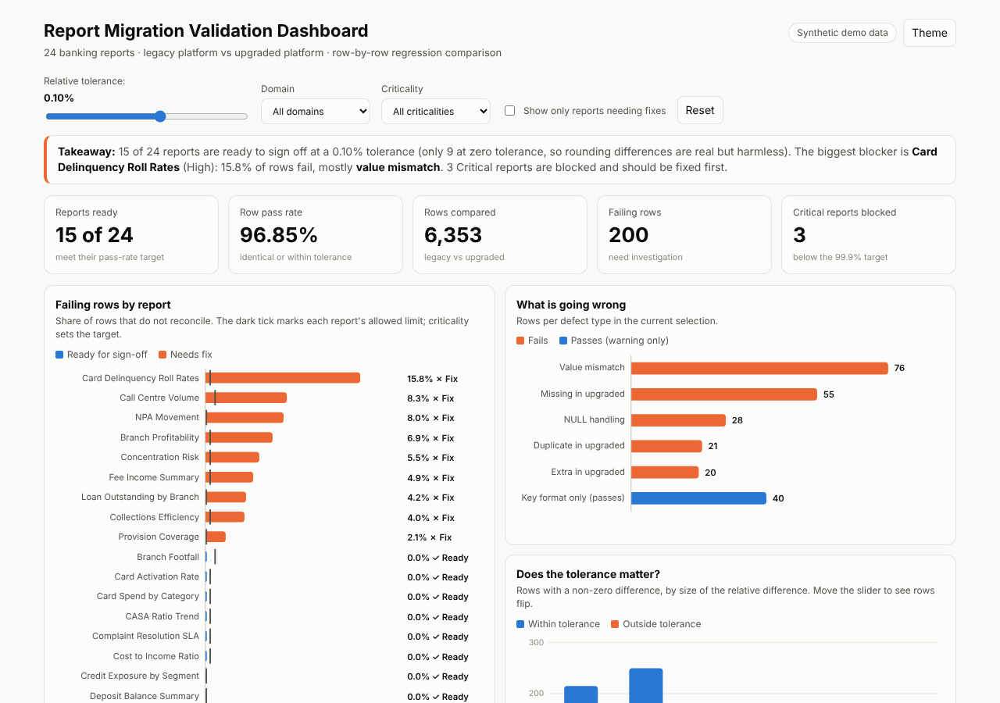

# Report Migration Validation Dashboard

An interactive dashboard that checks whether 24 banking reports give the **same numbers after a BI platform upgrade**, and tells you which ones are safe to sign off.

> **All data is synthetic.** It is generated by `scripts/generate_data.py`. No real bank, report, customer or employer data is used.

**Live dashboard:** enable GitHub Pages (Settings > Pages > branch `main`, folder `/dashboard`) and paste the URL here.



## What it shows

- Legacy vs upgraded output compared **row by row** (6,353 rows across 24 reports).
- A **tolerance slider**: tighten it and reports that looked fine start to fail.
- Filters by domain and criticality, plus a "needs fix only" toggle.
- Reports failing their sign-off target (Critical 99.9%, High and Medium 99.5%, Low 99.0%).
- Defect types and a defect log with example keys.

## Key findings (synthetic data)

- Overall pass rate is **96.8%**; **15 of 24** reports are ready for sign-off and **9 need a fix**.
- **3 Critical reports are blocked:** Loan Outstanding by Branch, NPA Movement, Provision Coverage.
- Worst report: Card Delinquency Roll Rates at 84.2% (an aggregation difference for one product).
- Root causes injected and detected: NULL coalesced to 0, missing rows, join fan-out duplicates, a month cut-off shift, key formatting (case and spaces) and rounding noise.

## How each row is classified

`MATCH`, `WITHIN_TOLERANCE`, `KEY_FORMAT` (pass); `VALUE_MISMATCH`, `NULL_HANDLING`, `MISSING_IN_UPGRADED`, `EXTRA_IN_UPGRADED`, `DUPLICATE_IN_UPGRADED` (fail).
Default tolerance: absolute 0.01 or relative 0.1%. Every legacy and upgraded row is classified exactly once; `validate.py` asserts this.

## Built with

| Part | Tool |
|---|---|
| Dashboard | HTML, CSS, JavaScript with inline SVG charts (no libraries, one offline file) |
| Data and validation | Python (pandas, numpy) |
| Comparison logic | SQL Server style `FULL OUTER JOIN` in `sql/validation_compare.sql` |
| Power BI | DAX measures and build guide in `powerbi/` |

## Run it

```bash
pip install pandas numpy
python scripts/generate_data.py
python scripts/validate.py          # options: --rel-tol 0.001 --abs-tol 0.01
python scripts/build_dashboard.py
# open dashboard/index.html
```

## Verification

The SQL was run against the same data (in SQLite with exact decimal rounding to match SQL Server `DECIMAL`) and gives the same row counts, pass rows and pass rates as the Python script for all 24 reports.

## Power BI version

Follow `powerbi/DAX_measures.md` to rebuild this in Power BI Desktop. Add your `.pbix` and a screenshot to this repo.

## License

MIT, see `LICENSE`.
